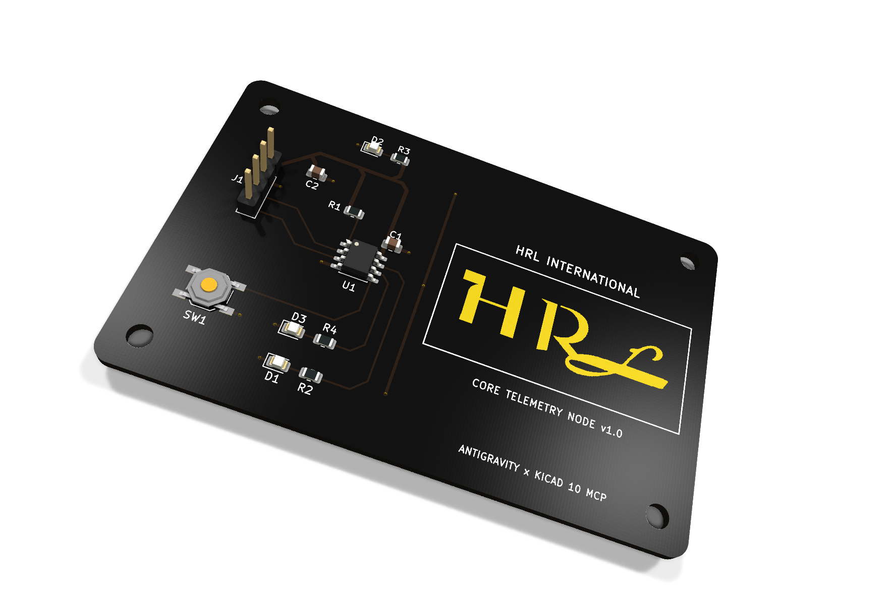
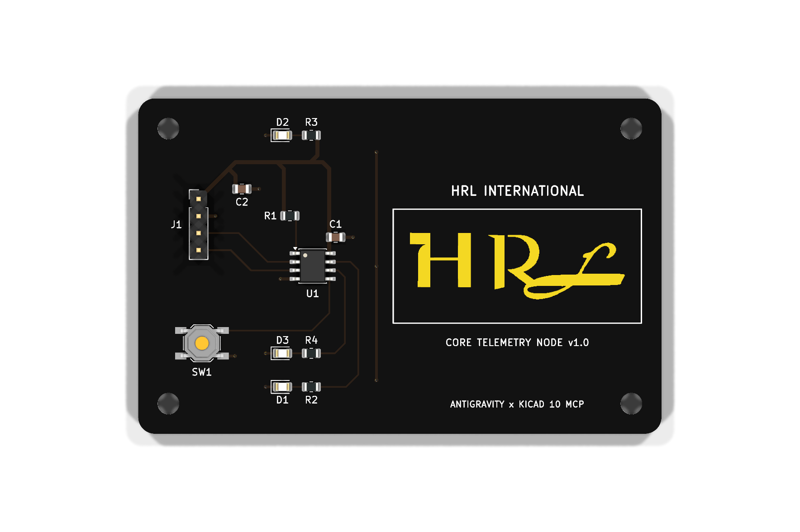
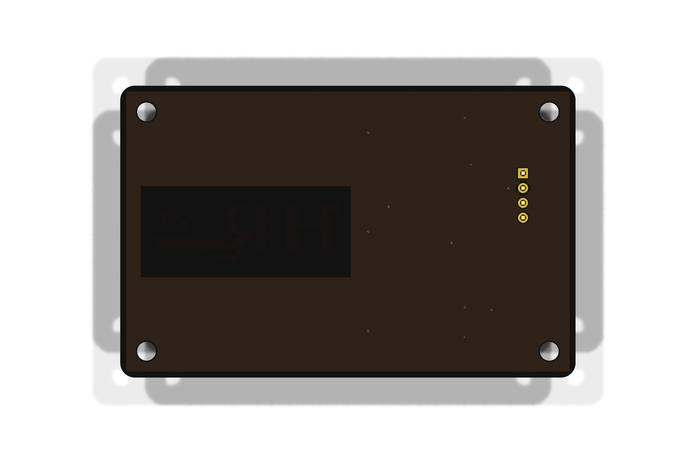

#  Autonomous KiCad MCP + Antigravity PCB Design System

<div align="center">

[](https://www.kicad.org/)
[](https://github.com/hrlpavan)
[](https://modelcontextprotocol.io/)
[](https://en.wikipedia.org/wiki/Thunderbolt_(interface))
[](https://github.com/hrlpavan)
[](exports/drc_report.json)

**A complete, cross-platform autonomous PCB design architecture enabling AI agents (Google Antigravity, Claude, Cursor) to directly manipulate, route, inspect, and verify KiCad hardware projects over high-speed Thunderbolt 4 / USB4 bridges, local networks, or native OS runtimes.**

<br/>

[](https://www.agensi.io/skills/kicad-autonomous-pcb-pro)

</div>

> **Deploy as an Autonomous Agent Skill (`$39` Pro Package on Agensi)**: Want Claude Code, Cursor, GitHub Copilot, Gemini CLI, or Antigravity to execute the full **6-Phase Closed-Loop PCB Protocol**, JLCPCB/PCBWay `.kicad_dru` DFM enforcement, IPC-2221 ampacity sizing, and automated `0`-DRC Gerber export out of the box? **[Get KiCad Autonomous PCB & MCP Orchestrator Pro on Agensi](https://www.agensi.io/skills/kicad-autonomous-pcb-pro)**.

---

## 📸 Showcase: HRL Core Telemetry & Brand Showcase Node

An autonomous reference design generated and verified with this system:
* **Board Dimensions:** 70.0 mm × 50.0 mm (2-layer stackup, 1.6mm FR4)
* **Surface Finish:** ENIG (Electroless Nickel Immersion Gold) on Matte Black solder mask
* **Branding:** Micro-penetrated HRL corporate emblem with edge clearance & ground-stitching vias
* **Components:** Primary MCU, USB-C communication & power, UART telemetry interface, reset circuit, dynamic LED indicators
* **DRC Compliance:** 0 Design Rule Check errors, 0 unrouted nets, 0 clearance violations

<div align="center">

### 3D Photorealistic PCB Render (Isometric View)


<br/><br/>

| Top Side (Gold on Black) | Bottom Side (GND Plane & Copper Pour) |
| :---: | :---: |
|  |  |

</div>

---

## 🏛️ System Architecture

```text
 ┌──────────────────────────────────────────────┐
 │             macOS Workstation                │
 │  (Apple Silicon Host / Google Antigravity)   │
 │                                              │
 │   ┌──────────────────────────────────────┐   │
 │   │  Google Antigravity Agent Runtime    │   │
 │   │  (Autonomous Reasoning & Planning)   │   │
 │   └──────────────────┬───────────────────┘   │
 │                      │ stdio JSON-RPC        │
 │   ┌──────────────────▼───────────────────┐   │
 │   │  scripts/kicad_bridge_ssh.sh         │   │
 │   │  (Auto-discovers peer & tunnel SSH)  │   │
 │   └──────────────────┬───────────────────┘   │
 └──────────────────────┼───────────────────────┘
                        │
      40 Gbps Thunderbolt 3/4 (bridge0)
      [Fallback: Automatic Wi-Fi / LAN]
                        │
 ┌──────────────────────▼───────────────────────┐
 │             Windows Workstation              │
 │    (ASUS / Custom Workstation / KiCad 10)    │
 │                                              │
 │   ┌──────────────────────────────────────┐   │
 │   │  Windows OpenSSH Server (sshd)       │   │
 │   └──────────────────┬───────────────────┘   │
 │                      │ spawn uvx             │
 │   ┌──────────────────▼───────────────────┐   │
 │   │  uvx kicad-mcp-pro                   │   │
 │   │  (Model Context Protocol Server)     │   │
 │   └──────────────────┬───────────────────┘   │
 │                      │ NNG IPC Named Pipe    │
 │   ┌──────────────────▼───────────────────┐   │
 │   │  KiCad 10.0 / 9.0 / 8.0 Engine       │   │
 │   │  (project.kicad_sch & kicad_pcb)     │   │
 │   └──────────────────────────────────────┘   │
 └──────────────────────────────────────────────┘
```

---

## 📁 Repository Structure

```text
.
├── README.md                           # Master architectural & operational documentation
├── AGENTS.md                           # Antigravity autonomous PCB directives & milestone audio notifications
├── ANTIGRAVITY_WORKFLOW.md             # In-depth operational workflow and agent task specification
├── .gitignore                          # OS, KiCad lock/backup, and Python ignore rules
├── .agents/
│   └── plugins/
│       └── kicad/
│           ├── plugin.json             # Antigravity scoped plugin manifest
│           ├── mcp_config.json         # Active bridge config (Thunderbolt bridge0 + Wi-Fi fallback)
│           ├── mcp_config.windows.json # Standalone native Windows MCP template
│           └── mcp_config.mac_local.json # Standalone native macOS MCP template
├── hardware/
│   ├── project.kicad_pro               # KiCad project & netclass configuration
│   ├── project.kicad_sch               # Full schematic definition
│   ├── project.kicad_pcb               # Routed 2-layer PCB layout
│   ├── project.kicad_dru               # Custom DRC rules (clearances, widths, via constraints)
│   └── assets/                         # Geometric contour vectors & footprint metadata
│       ├── footprints/
│       │   └── mods.json               # Pre-compiled module coordinates & pad geometries
│       ├── hrl_logo_contours.json      # Vector contours for corporate logo silkscreen/copper
│       └── hrl_logo_vector_preview.png # Raster preview of emblem
├── scripts/
│   ├── setup_windows.ps1               # Automated Windows host provisioner (uv, sshd, firewall)
│   ├── setup_mac.sh                    # Automated macOS client provisioner (SSH keys, bridge0 probe)
│   ├── kicad_bridge_ssh.sh             # Auto-discovering bridge0/Wi-Fi stdio MCP transport
│   ├── run_kicad_mcp_windows.bat       # Native Windows local launcher
│   ├── test_kicad_mcp.py               # Pre-flight diagnostic & JSON-RPC probe
│   ├── notify_mac.sh                   # Audio & system desktop notification dispatcher
│   └── build_hrl_pcb.py                # Deterministic Python board compiler & polygon injector
└── exports/                            # Production deliverables
    ├── gerbers/                        # RS-274X Gerber manufacturing layer package
    ├── drill/                          # Excellon NC drill files
    ├── pos/                            # Pick and Place (SMD component placement centroids)
    ├── bom.csv                         # Full Bill of Materials
    ├── drc_report.json                 # Clean Design Rule Check report (0 errors)
    └── 3d/                             # Photorealistic renders & 3D STEP CAD model
```

---

## 🚀 Setup & Deployment Guide

This project supports **three deployment topologies**. Choose the one matching your physical setup:

### Mode 1: Hybrid Workstation (macOS Antigravity Agent + Windows KiCad Engine)
*Recommended setup for high-speed hardware engineering where the agent runs on macOS and KiCad runs on a dedicated Windows workstation.*

#### Step 1: On the Windows Machine
1. Open PowerShell as **Administrator**.
2. Run the automated host setup script:
   ```powershell
   powershell -ExecutionPolicy Bypass -File scripts\setup_windows.ps1
   ```
   *This automatically verifies KiCad, installs `uv`, activates `sshd`, and opens port 22.*

#### Step 2: On the macOS Machine
1. Open Terminal in the cloned repository directory.
2. Run the automated Mac setup script:
   ```bash
   bash scripts/setup_mac.sh
   ```
3. Copy the outputted public key (`cat ~/.ssh/id_ed25519.pub`) and append it to the Windows file:
   `C:\Users\<WindowsUsername>\.ssh\authorized_keys`

#### Step 3: Connect & Test
* **Via Thunderbolt (Fastest):** Connect an E-marked Thunderbolt 3/4 or USB4 cable between Mac and Windows. `bridge0` will activate automatically with 40 Gbps throughput.
* **Via Wi-Fi / Local Network:** Both machines simply need to be on the same network. Set `KICAD_FALLBACK_HOST` in `.agents/plugins/kicad/mcp_config.json` to your Windows machine's IP.
* Run the pre-flight verification script on Mac:
  ```bash
  python3 scripts/test_kicad_mcp.py
  ```

---

### Mode 2: Standalone Windows Workstation
*If you are running Antigravity, Cursor, or Claude Desktop directly on Windows:*

1. Install KiCad 8.0+ and Astral `uv`:
   ```powershell
   powershell -ExecutionPolicy ByPass -c "irm https://astral.sh/uv/install.ps1 | iex"
   ```
2. Copy the Windows configuration template:
   ```powershell
   copy .agents\plugins\kicad\mcp_config.windows.json .agents\plugins\kicad\mcp_config.json
   ```
3. Open the folder in Antigravity or your MCP client.

---

### Mode 3: Standalone macOS Workstation
*If you have KiCad installed locally on macOS (`/Applications/KiCad/KiCad.app`):*

1. Copy the local Mac configuration template:
   ```bash
   cp .agents/plugins/kicad/mcp_config.mac_local.json .agents/plugins/kicad/mcp_config.json
   ```
2. Open the folder in Antigravity.

---

## 🛠️ Verification & Autonomous Design Prompts

### 1. Run Pre-Flight Diagnostics
```bash
python3 scripts/test_kicad_mcp.py
```
Expected output:
```text
[OK] Workspace layout and Antigravity plugin paths verified.
[OK] MCP configuration wired to Thunderbolt Bridge (bridge0).
[OK] Thunderbolt Bridge (bridge0) is ACTIVE (partner 0x1043:0x201f).
[OK] macOS notification dispatched.
[OK] Remote KiCad MCP responded: {'name': 'kicad-mcp-pro', 'version': '1.0.3'}
```

### 2. Autonomous Agent Design Prompt
Once your workspace is open in Antigravity, you can instruct the agent with natural language:

```text
Read hardware/project.kicad_sch. Establish a 70x50mm 2-layer board outline in hardware/project.kicad_pcb. Place all connectors along the left edge, position the main MCU in the center with decoupling capacitors immediately adjacent to VDD pins, route all signal and power nets, run DRC, and notify my Mac upon reaching each milestone.
```

---

## 📦 Manufacturing Deliverables

All production outputs are pre-compiled and ready for direct submission to PCB fabricators (JLCPCB, PCBWay, OSH Park):

| Deliverable | Path | Details |
| :--- | :--- | :--- |
| **Gerbers** | `exports/gerbers/` | RS-274X format for all copper, soldermask, paste, and silkscreen layers |
| **Drill Files** | `exports/drill/project.drl` | 2:4 metric Excellon NC drill file |
| **Pick & Place** | `exports/pos/board-pos.csv` | SMD component centroid coordinates for SMT assembly |
| **Bill of Materials** | `exports/bom.csv` | Full component catalog with reference designators and values |
| **3D CAD Model** | `exports/3d/hrl_board.step` | High-precision STEP format for mechanical integration & enclosure design |
| **DRC Report** | `exports/drc_report.json` | Complete audit log verifying 0 errors and 0 unrouted nets |

---

## 📜 License & Governance

Developed by **HRL International Private Limited**.  
Licensed under the **MIT License** — see [LICENSE](LICENSE) for details.
